# implement/research — รายงานผลการทดลอง: การแบ่งส่วนวัสดุก่อสร้าง (gravel / sand) ด้วย YOLO26n-seg

เอกสารนี้สรุปขั้นตอน ผลการทดลอง ข้อจำกัด และปัญหาที่ยังค้างของ pipeline วิจัยฉบับปรับปรุง (Notebook 01–04 และ 03.5) ตัวเลขทั้งหมดอ่านจากไฟล์ใน `outputs/` ที่ notebook บันทึกไว้ในการรันครั้งล่าสุด (18 ตุลาคม 2569) แผนการวิจัยฉบับเต็ม การตัดสินใจเชิงวิธีการ และบันทึกการเปลี่ยนแปลงอยู่ใน [RESEARCH_PLAN.md](RESEARCH_PLAN.md)

**สถานะ:** ชุด test (Notebook 03) และชุด holdout (Notebook 04) ถูกเปิดประเมินแล้วครั้งเดียว (`outputs/03_yolo_experiments/evaluation/TEST_OPENED.json`, `outputs/04_holdout/HOLDOUT_OPENED.json`) การเปลี่ยนแปลงใด ๆ หลังจากนี้ต้องรายงานเป็นการวิเคราะห์หลังเปิดผล

## สารบัญ

1. [สรุปผลหลัก](#1-สรุปผลหลัก)
2. [ภาพรวมของ pipeline](#2-ภาพรวมของ-pipeline)
3. [Notebook 01: ชุดข้อมูลและการแบ่งชุดข้อมูล](#3-notebook-01-ชุดข้อมูลและการแบ่งชุดข้อมูล)
4. [Notebook 02: preprocessing และ augmentation](#4-notebook-02-preprocessing-และ-augmentation)
5. [Notebook 03: การฝึก สถาปัตยกรรม และการประเมินบน test](#5-notebook-03-การฝึก-สถาปัตยกรรม-และการประเมินบน-test)
6. [Notebook 03.5: การประเมินแบบจำลองที่ตรึงไว้โดยละเอียด](#6-notebook-035-การประเมินแบบจำลองที่ตรึงไว้โดยละเอียด)
7. [Notebook 04: holdout, standardization และวิดีโอ](#7-notebook-04-holdout-standardization-และวิดีโอ)
8. [ข้อจำกัด](#8-ข้อจำกัด)
9. [Bug ที่ยังไม่แก้ warning และ error](#9-bug-ที่ยังไม่แก้-warning-และ-error)
10. [การรันซ้ำ](#10-การรันซ้ำ)

---

## 1. สรุปผลหลัก

แบบจำลองที่ตรึงไว้คือ YOLO26n-seg (3.08 ล้านพารามิเตอร์, 10.4 GFLOPs ที่ 640 พิกเซล) ฝึกด้วยสูตร A9 (offline augmentation ของสภาพแวดล้อม + copy-paste + unsharp masking) ด้วย AdamW 20 epoch (seed 42)

| ชุดข้อมูล | ภาพ | mask AP | mask AP50 | mask AP gravel / sand | accuracy ของสถานะระดับภาพ | macro-F1 ของสถานะ |
|---|---:|---:|---:|---:|---:|---:|
| val (ใช้เลือกแบบจำลอง) | 131 | 0.582 | 0.771 | 0.689 / 0.476 | 0.962 | 0.838 |
| grouped CV 3 fold (train+val) | 529 | 0.415 (0.28 / 0.53 / 0.43) | — | 0.59 / 0.24 | — | 0.57 |
| **test** (7 กลุ่มที่ไม่เคยเห็น) | 244 | **0.437** [0.22, 0.64] | 0.739 | 0.523 / 0.350 | **0.934** | **0.928** |
| holdout: piled_materials | 1,095 | 0.173 | — | 0.153 / 0.194 | 0.574 | 0.378 |
| holdout: separate_rock_sand | 182 | 0.105 | — | 0.065 / 0.144 | 0.236 | 0.098 |

ช่วงใน [ ] คือช่วงความเชื่อมั่น 95% แบบ cluster bootstrap

ข้อค้นพบหลัก

1. **การจำแนกสถานะระดับภาพทำได้ดีกว่าการแบ่งส่วนระดับ instance อย่างชัดเจน** บนชุด test ระบบจำแนกสถานะถูกต้อง 93.4% ขณะที่ mask AP อยู่ที่ 0.437 เนื่องจากความผิดพลาดส่วนใหญ่ของ instance เป็นการแบ่งขอบเขตของกองวัสดุไม่ตรงกับ annotation มากกว่าการทายวัสดุผิดชนิด (ความสับสนระหว่าง gravel กับ sand ระดับ instance มีเพียง 0–2 รายการ)
2. **ประสิทธิภาพลดลงตามระยะห่างของ distribution** จาก val (0.58) ไป test (0.44) และ holdout ภายนอก (0.10–0.17) แบบจำลองยังไม่ generalize ไปยังฉากและอุปกรณ์ถ่ายภาพที่ต่างจากชุดพัฒนา
3. **Augmentation ช่วยอย่างมีนัย** (A0 ไม่มี augmentation 0.473 เทียบกับ A1 ค่าเริ่มต้น 0.558 และ A3 photometric 0.582) แต่ **การปรับสถาปัตยกรรมทั้งหมดไม่ช่วย** (CBAM, ECA, C3k2 `attn=True` ห้าตำแหน่ง, MuSGD และ SAHI ไม่มีตัวใดดีกว่า baseline เกินส่วนเบี่ยงเบนมาตรฐาน)
4. **วัตถุขนาดเล็กเป็นจุดอ่อนที่สม่ำเสมอ** (mask AP_small 0.09 บน val และ 0.13 บน test) แต่ 85% ของ instance ขนาดเล็กใน val เป็นเศษของกองวัสดุที่ถูกบดบังหรือถูกตัดที่ขอบภาพ มากกว่าเป็นวัตถุขนาดเล็กจริง
5. **มีหลักฐานของ shortcut สำหรับ sand** เมื่อลบบริเวณวัสดุออกจากภาพด้วย inpainting คะแนนของ sand ยังเหลือ 41% (median) ของคะแนนเดิม ขณะที่ gravel เหลือ 2% แบบจำลองจึงน่าจะใช้บริบทของฉากในการทำนาย sand บางส่วน
6. **พบ bug ที่กระทบผลหลัก** สูตร A9 ไม่ได้รวม A3_photometric ซึ่งเป็น augmentation เดี่ยวที่ดีที่สุด แม้ไฟล์การตั้งค่าจะระบุว่ารวมไว้ (รายละเอียดในหัวข้อ 9.1)

---

## 2. ภาพรวมของ pipeline

### 2.1 Flow diagram

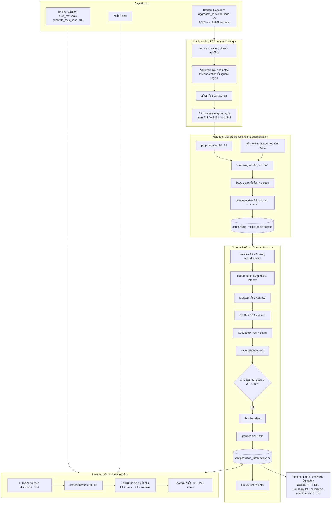

### 2.2 Class diagram ของโค้ดหลักและโครงสร้างของแบบจำลอง

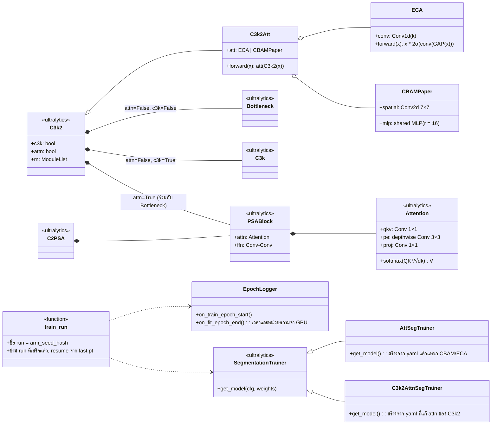

---

### 2.3 สถาปัตยกรรม YOLO26n-seg และบล็อกที่ทดลองปรับ

รูปด้านล่างเป็นแผนผังอ้างอิงของตระกูล YOLO (บล็อก C2f) ไม่ใช่สถาปัตยกรรมที่ใช้จริง YOLO26 ใช้ **C3k2** แทน C2f และ **Segment26** เป็น head ผู้จัดทำรูปคือ Priyanto Hidayatullah และ Refdinal Tubagus (ใช้เป็นภาพประกอบเท่านั้น) ตารางถัดไปอ้างอิงจากโมเดลที่ติดตั้งจริง (`yolo26-seg.yaml`, layer index ตามที่ Ultralytics ใช้)

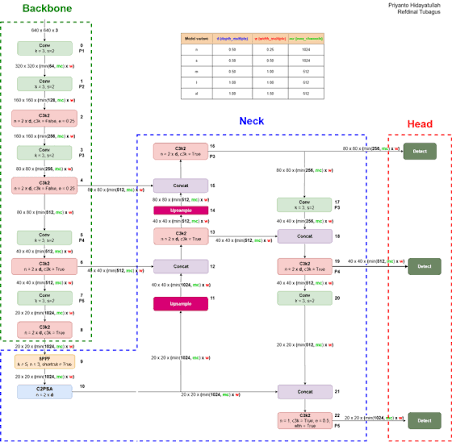

| Index | Module | From | Parameters (n) | หมายเหตุ |
|---|---|---|---:|---|
| 0–1 | Conv, Conv | input | 0.5 K, 4.7 K | stride 2 (P1, P2) |
| 2 | C3k2 | 1 | 6.6 K | backbone P2 |
| 3 | Conv | 2 | 37.0 K | P3 |
| 4 | C3k2 | 3 | 26.1 K | backbone P3 |
| 5 | Conv | 4 | 147.7 K | P4 |
| 6 | C3k2 | 5 | 87.0 K | backbone P4 |
| 7 | Conv | 6 | 295.4 K | P5 |
| 8 | C3k2 | 7 | 346.1 K | backbone P5 |
| 9 | SPPF | 8 | 164.6 K | pooling |
| 10 | C2PSA | 9 | 249.7 K | attention (ชั้นที่ 1) |
| 11, 14 | Upsample | — | 0 | |
| 12, 15, 18, 21 | Concat | — | 0 | skip connection |
| 13, 16, 19, 22 | C3k2 | — | 119.8 K, 34.3 K, 95.2 K, 463.1 K | neck/head (22 ใช้ `attn=True`) |
| 17, 20 | Conv | — | 37.0 K, 147.7 K | downsample ใน PAN |
| 23 | Segment26 | [16, 19, 22] | 863.7 K | head P3, P4, P5 |

**บล็อกที่การทดลองปรับ** (ทุกการปรับเป็นการแก้ argument ของชั้นนี้ ไม่มีการเพิ่มโมดูลเอง ยกเว้น CBAM/ECA ของรอบแรก)

| การทดลอง | ชั้นที่ถูกปรับ | สิ่งที่เปลี่ยน | รอบ | สถานะ |
|---|---|---|---|---|
| Augmentation / preprocessing | ไม่ใช่ block | ข้อมูลเข้า (offline/online aug, P1–P5) | 1, 2 | รอบสองแก้ A9 ให้รวม A3 |
| C1 CBAM ที่ P3 | 16 | แทรก CBAM หลัง C3k2 | 1, 2 (ฝึกใหม่) | รอบสองฝึกใหม่ |
| C2 ECA ที่ P3 | 16 | แทรก ECA | 1 | รายงานจากรอบแรก |
| C3 / C4 CBAM / ECA P3–P5 | 16, 19, 22 | แทรก attention ทั้งสามระดับ | 1 | รายงานจากรอบแรก |
| A0 ถอด attention | 22 | `attn=False` | 1, 2 (ฝึกใหม่) | รอบสองฝึกใหม่ |
| A1–A4 เพิ่ม attention | 16, 19, 6, 8 | `attn=True` | 1 | รายงานจากรอบแรก |
| R1 imgsz 960 | ไม่ใช่ block | ความละเอียดอินพุต | 2 | ใหม่ |
| R2 YOLO26s-seg | ทุก block (scale s) | เปลี่ยน depth/width | 2 | ใหม่ |
| R3 hard-group oversampling | ไม่ใช่ block | ข้อมูลฝึกซ้ำกลุ่มยาก | 2 | ใหม่ |
| MuSGD | ไม่ใช่ block | optimizer | 1 | ไม่ฝึกในรอบสอง |

**ข้อสังเกต:** เฉพาะ C1 และ A0 ที่ฝึกใหม่ในรอบสอง ตามที่ตกลงไว้ (arm ที่ดีที่สุดของแต่ละกลุ่มในรอบแรก) ที่เหลือรายงานจากรอบแรกและแยกไว้ชัดเจน

## 3. Notebook 01: ชุดข้อมูลและการแบ่งชุดข้อมูล

**ชุดข้อมูล:** Roboflow `aggregate_rock-and-sand` v5 จำนวน 1,089 ภาพ (JPEG/RGB) และ 6,023 instance (gravel 2,876 / sand 3,147) หลังรวมกลุ่มของวิดีโอและภาพเกือบซ้ำ (pHash, d ≤ 8) เหลือ 27 กลุ่ม

**ปัญหาของ annotation ใน bronze:** geometry ตัดกันเอง 253 ชิ้น พื้นที่ศูนย์ 154 ชิ้น จุดยอดน้อยกว่า 3 จุด 55 ชิ้น และ polygon คลาสเดียวกันซ้อนทับกัน 2,086 คู่ (median IoMin 0.99) ซึ่งส่วนใหญ่เป็นการวาดทั้งกองซ้อนกับส่วนย่อย กฎ Silver ซ่อมและรวม annotation ได้ 4,375 instance โดย 324 instance ที่มีพื้นที่น้อยกว่า 0.1% ของภาพใช้ฝึกแต่เป็น ignore region ในการประเมิน

**ตัวแปรกวน:** คลาสผูกกับแหล่งที่มาของภาพอย่างมาก (Cramér's V = 0.98) และกับความละเอียดของภาพ (V = 0.63)

**การแบ่งชุดข้อมูล:** เปรียบเทียบ 4 กลยุทธ์ และเลือก S3

| กลยุทธ์ | ผลในชุดข้อมูลนี้ |
|---|---|
| S0 สุ่มระดับภาพ (Roboflow) | คู่ภาพเกือบซ้ำข้าม split 6,948 คู่ ระยะ pHash จากภาพทดสอบถึงภาพฝึกที่ใกล้ที่สุด median 2 |
| S1 `GroupShuffleSplit` | ขนาด test แปรผัน 4.8–42.6% และ 9% ของ seed ได้ test ที่ไม่มี sand |
| S2 `StratifiedGroupKFold` | stratify ไม่ได้เพราะมีกลุ่มขนาดใหญ่จำนวนน้อย |
| **S3 constrained group split** | ไม่มี leakage, ทุก split มีทั้งสองคลาส, median d = 20 |

ผลการแบ่ง: train 714 ภาพ (66%), val 131 ภาพ (12%, 3 กลุ่ม), test 244 ภาพ (22%, 7 กลุ่ม) และ grouped CV 3 fold ภายในชุดพัฒนา

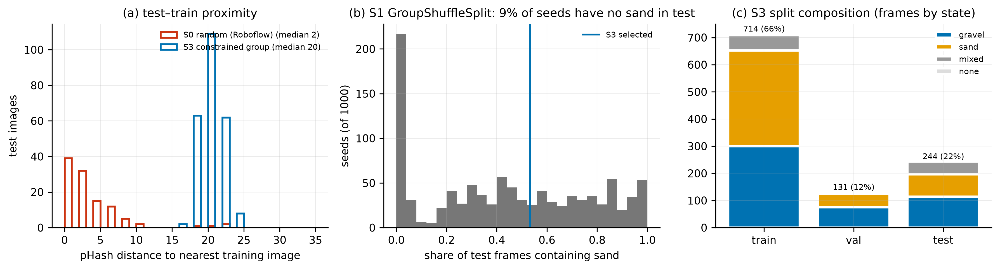

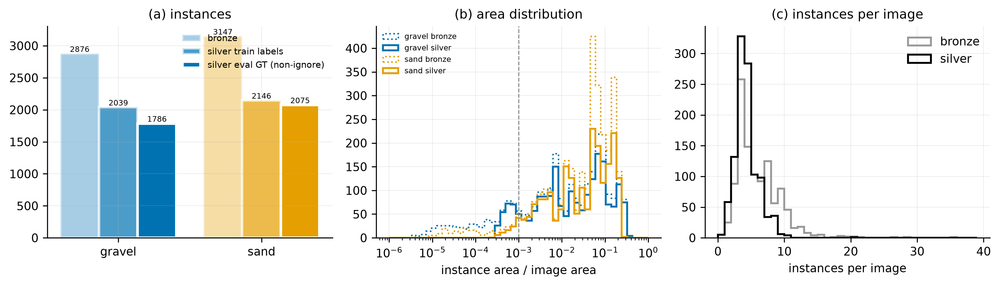

---

## 4. Notebook 02: preprocessing และ augmentation

**ชุดข้อมูล:** train 714 ภาพ (และชุด offline augmentation ที่สร้างจาก train) ประเมินบน val 131 ภาพ และ val-C (val ที่ใส่การรบกวนจำลอง dark, dust, rain × 5 ระดับ) ทุก arm ฝึกด้วยจำนวน optimizer step เท่ากัน (iteration-matched: 80 epoch บน 714 ภาพ)

### 4.1 Augmentation ablation (seed 42)

| Arm | การตั้งค่า | mask AP | mPC (val-C) | rPC |
|---|---|---:|---:|---:|
| A0 | ไม่มี augmentation | 0.473 | 0.287 | 0.61 |
| A1 | ค่าเริ่มต้นของ Ultralytics | 0.552 | 0.387 | 0.70 |
| A2 | + rotation 10° | 0.561 | 0.452 | 0.81 |
| A3 | + photometric (offline) | 0.581 | 0.453 | 0.78 |
| A4 | + rain (offline) | 0.557 | 0.429 | 0.77 |
| A5 | + dark (offline) | 0.554 | 0.481 | 0.87 |
| A6 | + dust (offline) | 0.568 | 0.429 | 0.75 |
| A7 | + rain, dark, dust (offline) | 0.583 | 0.475 | 0.81 |
| A8 | + copy-paste 0.3 (online) | 0.579 | 0.437 | 0.75 |

ยืนยันด้วย 3 seed: A1 0.558 ± 0.006, A3 **0.582 ± 0.005**, A7 0.567 ± 0.016, A8 0.569 ± 0.015 ทั้งสาม arm ผ่านเกณฑ์ (ดีกว่า A1 เกิน 1 SD ทั้งภาพปกติและ mPC)

**Preprocessing:** P5 unsharp masking +0.012 (ผ่านเกณฑ์) P3 gamma อัตโนมัติ +0.003 (ไม่ผ่าน)

**สูตรที่เลือก (A9):** mask AP 0.581 ± 0.002 (3 seed) เทียบกับ A1 0.558 แต่ **ไม่ดีกว่า A3 เดี่ยว** เพราะ A9 ไม่ได้รวม A3 จริง (หัวข้อ 9.1)

ผลระดับ instance ที่ conf ≥ 0.25 (คำนวณเพิ่มเติมนอก notebook จาก detection ที่ cache ไว้) แสดงว่า augmentation ลด FN เป็นหลัก (A3 ลด FN 24 รายการเทียบกับ A1) ขณะที่ A4 rain เพิ่ม FP มากที่สุด (+36)

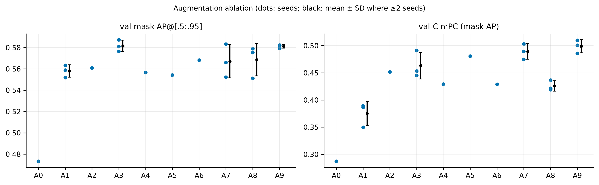

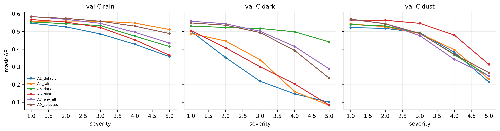

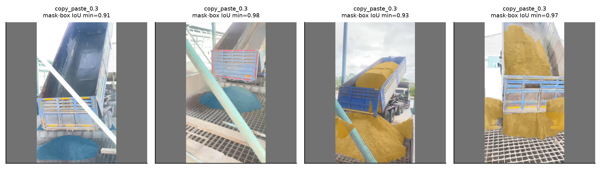

---

## 5. Notebook 03: การฝึก สถาปัตยกรรม และการประเมินบน test

**ชุดข้อมูล:** ฝึกบนชุด A9 (2,856 ภาพหลัง offline augmentation) ประเมินบน val, grouped CV 3 fold และ test (ครั้งเดียว)

### 5.1 Baseline และความสามารถในการทำซ้ำ

| seed | mask AP | mask AP50 | gravel | sand | box AP |
|---|---:|---:|---:|---:|---:|
| 42 | 0.582 | 0.771 | 0.689 | 0.476 | 0.560 |
| 43 | 0.582 | 0.769 | 0.712 | 0.453 | 0.547 |
| 44 | 0.579 | 0.771 | 0.712 | 0.447 | 0.553 |

การฝึกซ้ำด้วย seed เดียวกันสองครั้งให้ค่า loss และ metric ต่างกัน 0.0 ทุก epoch (`reproducibility_abs_diff.csv`) จำนวน epoch (20) มาจากการทำ iteration matching ไม่ได้มาจาก early stopping (`patience = 20`) checkpoint ที่ดีที่สุดอยู่ที่ epoch 15

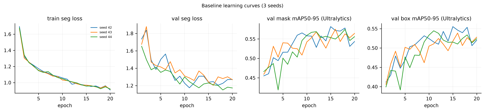

### 5.2 Optimizer

MuSGD (ค่าจาก checkpoint ทางการ) ได้ mask AP 0.565 ± 0.008 ต่ำกว่า AdamW (0.581 ± 0.002) ทุก seed ผลต่างแบบคู่ −0.016 ± 0.008

### 5.3 Attention และสถาปัตยกรรม

| กลุ่ม | Arm | การแก้ไข | mask AP (2 seed) | AP_small | GFLOPs |
|---|---|---|---:|---:|---:|
| — | **B** | baseline (attention ที่ชั้น 10, 22 ตามต้นฉบับ) | **0.582 ± 0.000** | 0.095 | 10.4 |
| CBAM/ECA (เขียนเอง) | C1 | CBAM ที่ P3 | 0.576 ± 0.013 | 0.098 | 10.4 |
| | C2 | ECA ที่ P3 | 0.568 ± 0.015 | 0.052 | 10.4 |
| | C3 | CBAM ที่ P3–P5 | 0.573 ± 0.002 | 0.072 | 10.4 |
| | C4 | ECA ที่ P3–P5 | 0.563 ± 0.005 | 0.112 | 10.4 |
| C3k2 `attn=True` (Ultralytics) | A0 | ถอด attention ชั้น 22 | 0.576 ± 0.018 | 0.096 | 10.3 |
| | A1 | + ชั้น 16 (P3, 80×80 token) | 0.551 ± 0.005 | 0.057 | 14.4 |
| | A2 | + ชั้น 19 (P4) | 0.569 ± 0.002 | 0.074 | 11.0 |
| | A3 | + ชั้น 16, 19 | 0.562 ± 0.006 | 0.053 | 15.0 |
| | A4 | + ชั้น 6, 8 (backbone) | 0.541 ± 0.012 | 0.061 | 11.1 |

ไม่มี arm ใดผ่านเกณฑ์ การเพิ่ม attention ทุกตำแหน่งทำให้ mask AP ลดลง และ attention ที่ P3 ไม่ช่วยวัตถุขนาดเล็ก (AP_small ลดจาก 0.095 เป็น 0.057) แผนที่ attention ของ C3k2 ที่ P3 และ P4 มี normalized entropy 0.90–0.95 คือกระจายเกือบทั่วภาพ ขณะที่ชั้น 22 ของ baseline (0.67–0.72) เพ่งที่บริเวณกองวัสดุ ‖output ของ attention‖ / ‖input‖ อยู่ระหว่าง 0.8–1.1 ทุกโมดูล attention จึงมีส่วนต่อ feature จริง GFLOPs ที่เพิ่ม 40% เมื่อใส่ attention ที่ P3 ทำให้ latency บน RTX 3080 Ti ที่ batch 1 เพิ่มเพียงประมาณ 1%

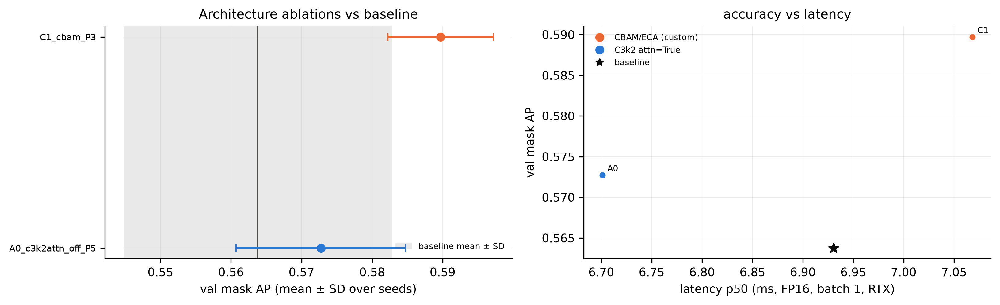

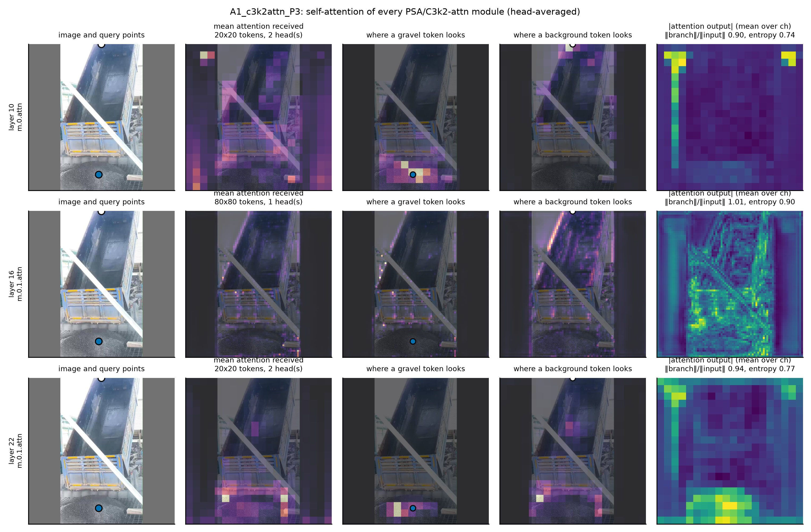

### 5.4 SAHI และ shortcut test

| วิธี | mask AP | AP_small | AP_medium | AP_large |
|---|---:|---:|---:|---:|
| inference ปกติ | 0.582 | 0.092 | 0.411 | 0.753 |
| SAHI (slice 320, overlap 0.2) | 0.382 | 0.009 | 0.147 | 0.561 |

**Shortcut test:** เมื่อลบบริเวณวัสดุทั้งหมดด้วย inpainting (เฉลี่ย 22% ของพื้นที่ภาพ) คะแนน $S_c$ ที่เหลือเทียบกับภาพเดิมมี median 2.4% สำหรับ gravel แต่ 40.8% สำหรับ sand

### 5.5 ต้นทุนการคำนวณ (RTX 3080 Ti)

| batch | FP32 p50 (ms) | FP16 p50 (ms) | FP16 throughput (ภาพ/วินาที) |
|---:|---:|---:|---:|
| 1 | 9.09 | 7.51 | 133 |
| 8 | 13.23 | 8.87 | 902 |
| 16 | 25.76 | 15.45 | 1,035 |

เวลาของ pipeline Ultralytics ที่ batch 1: preprocess 0.55 ms, inference 3.59 ms, postprocess 0.70 ms (ไม่รวม unsharp masking) ส่วน quantization และ Raspberry Pi 5 (หัวข้อ 10 ของ Notebook 03) ยังไม่ได้รัน

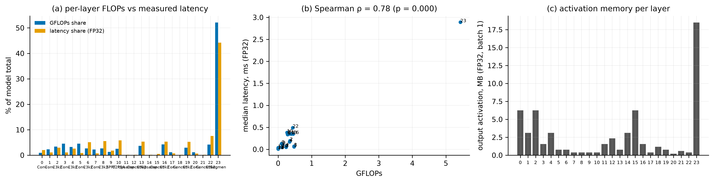

### 5.6 Grouped CV และการประเมินบน test

Grouped CV ของ baseline: mask AP 0.280 / 0.531 / 0.433 (fold 0–2) sand AP ใน fold 0 เท่ากับ 0.0001 แสดงว่าประสิทธิภาพของ sand ขึ้นกับว่ากลุ่มใดอยู่ใน train

**Test (244 ภาพ, 7 กลุ่ม, threshold ที่ตรึงไว้: gravel 0.24, sand 0.16)**

| ระดับ | ตัวชี้วัด | ค่า |
|---|---|---|
| instance | mask AP / AP50 / AP75 | 0.437 / 0.739 / 0.383 |
| | mask AP gravel / sand | 0.523 [0.44, 0.86] / 0.350 [0.00, 0.44] |
| | gravel: P / R / F1 | 0.642 / 0.809 / 0.716 (TP 359, FP 200, FN 85) |
| | sand: P / R / F1 | 0.480 / 0.681 / 0.563 (TP 196, FP 212, FN 92) |
| | mask IoU / Boundary IoU ของ TP | gravel 0.828 / 0.706, sand 0.795 / 0.691 |
| ภาพ | accuracy / balanced accuracy / macro-F1 / κ | 0.934 / 0.952 / 0.928 / 0.899 |

Confusion matrix ของสถานะบน test: gravel 99/114 ภาพถูก (15 ภาพทายเป็น mixed), sand 81/82, mixed 48/48

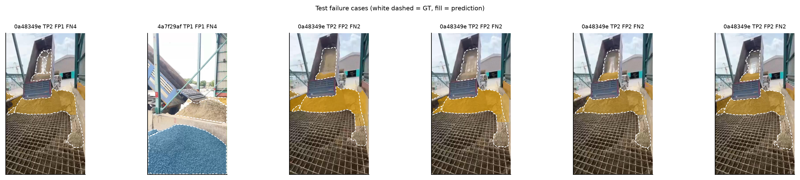

---

## 6. Notebook 03.5: การประเมินแบบจำลองที่ตรึงไว้โดยละเอียด

**ชุดข้อมูล:** หัวข้อ 3–14 ใช้ val (ซึ่งเป็นชุดที่ใช้เลือกแบบจำลองและ threshold จึงมี optimistic bias) หัวข้อ 13 ใช้ val-C และหัวข้อ 15 ใช้ detection ของ test ที่ Notebook 03 บันทึกไว้

### 6.1 Mask AP แยกตามขนาดของ instance (COCO: small < 32², medium < 96², large ≥ 96² พิกเซล)

| ชุด | ชนิด | AP | AP_small | AP_medium | AP_large | AR_small | AR_medium | AR_large |
|---|---|---:|---:|---:|---:|---:|---:|---:|
| val | mask | 0.582 | 0.092 | 0.411 | 0.753 | 0.361 | 0.572 | 0.841 |
| val | box | 0.560 | 0.147 | 0.417 | 0.702 | 0.507 | 0.617 | 0.830 |
| test | mask | 0.437 | 0.128 | 0.444 | 0.523 | 0.363 | 0.595 | 0.691 |
| test | box | 0.466 | 0.168 | 0.450 | 0.566 | 0.457 | 0.664 | 0.727 |

Recall ตามควอนไทล์ของพื้นที่ GT บน val ที่ threshold ที่ตรึงไว้

| พื้นที่ GT (พิกเซล) | gravel: n / recall | sand: n / recall |
|---|---|---|
| 219–2,019 | 16 / 0.19 | 68 / 0.41 |
| 2,019–11,551 | 38 / 0.82 | 46 / 0.67 |
| 11,551–27,515 | 65 / 0.83 | 18 / 0.67 |
| 27,515–31,752 | 43 / 0.93 | 41 / 1.00 |
| 31,752–55,039 | 63 / 0.87 | 21 / 1.00 |

ในบรรดา GT ขนาดเล็ก (< 2,019 พิกเซล) ของ val ทั้ง 84 ชิ้น 85% ติดขอบภาพหรืออยู่ห่างไม่เกิน 15 พิกเซลจาก instance ขนาดใหญ่ของคลาสเดียวกัน (sand 88%) ซึ่งเป็นเศษของกองเดียวที่ถูกเสาหรือคานบัง

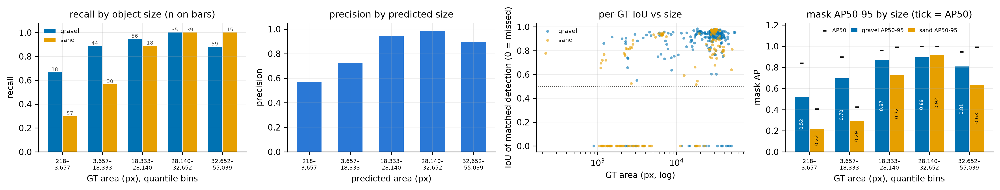

### 6.2 PR curve และ confusion matrix ระดับ instance

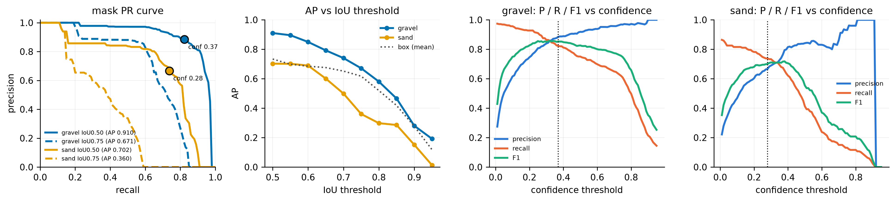

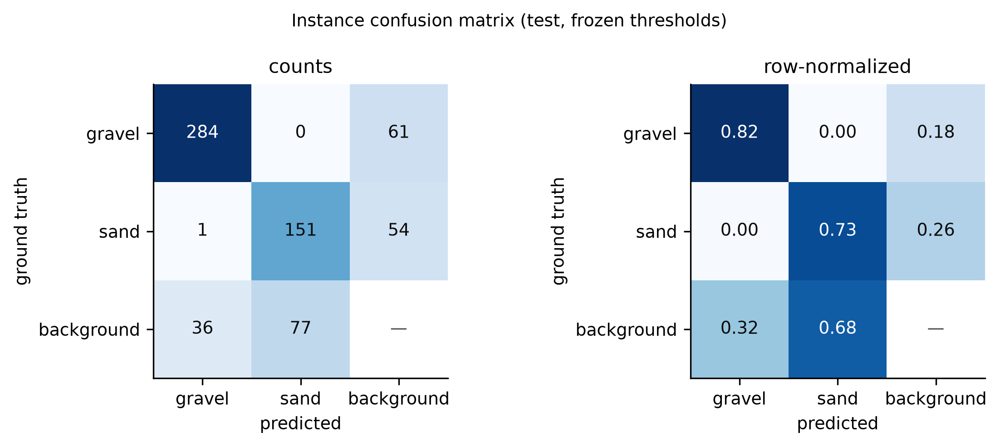

### 6.3 การจำแนกประเภทความผิดพลาด (TIDE, mask IoU)

| ประเภท | val ΔAP50 | val จำนวน | test ΔAP50 | test จำนวน |
|---|---:|---:|---:|---:|
| Cls | 0.0001 | 0 | 0.0048 | 2 |
| Loc | **0.0730** | 55 | 0.0236 | 54 |
| Both | 0.0003 | 1 | 0.0001 | 1 |
| Dupe | 0.0104 | 14 | 0.0267 | 123 |
| Bkg | 0.0353 | 34 | **0.0638** | 232 |
| Miss | 0.0144 | 77 | 0.0110 | 148 |

บน val ความผิดพลาดหลักคือ Loc (mask ครอบทั้งกองขณะที่ GT แบ่งเป็นหลายชิ้น) ส่วนบน test คือ Bkg (ทายวัสดุบนพื้นหลังของฉากใหม่) และ Dupe (mask ซ้อนหลายชิ้นบนกองเดียว)

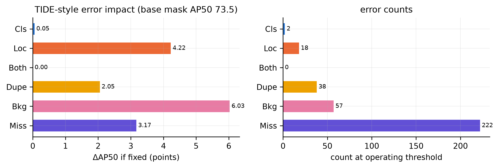

### 6.4 คุณภาพของ mask, calibration และผลรายกลุ่ม

D-ECE (15 ช่วง, conf ≥ 0.05): val gravel 0.082 / sand 0.089, test gravel 0.098 / sand 0.083 บน test แบบจำลองกลุ่ม gravel `0f964fdb` (111 ภาพ) ได้ mask AP 0.440 และกลุ่ม mixed `4a7f29af` ได้ gravel 0.869 / sand 0.445

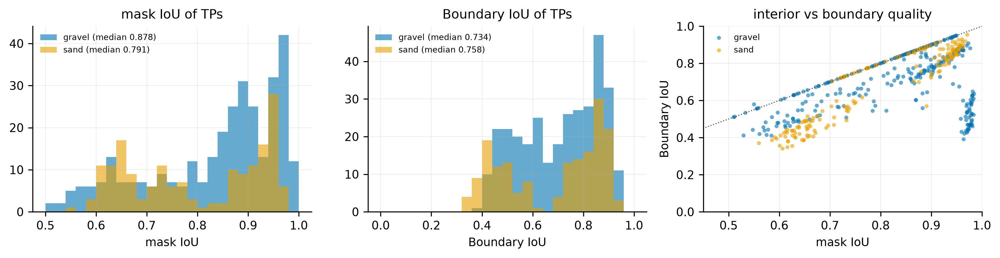

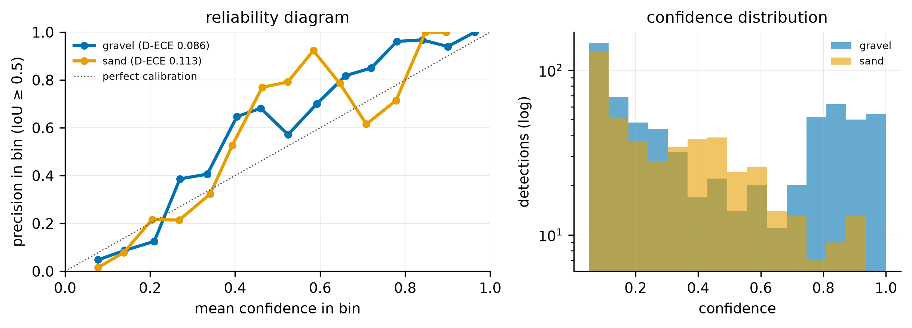

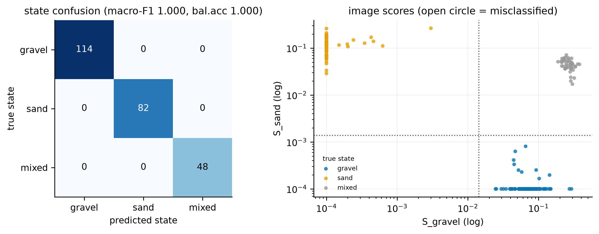

### 6.5 ภาพตัวอย่าง TP / FP / FN

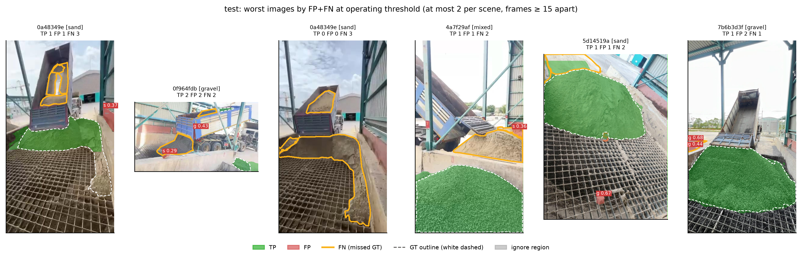

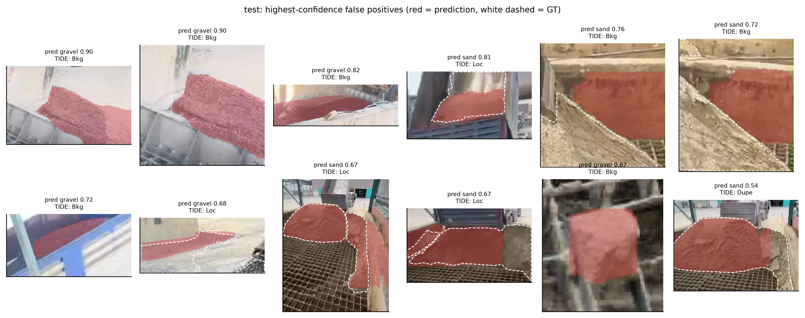

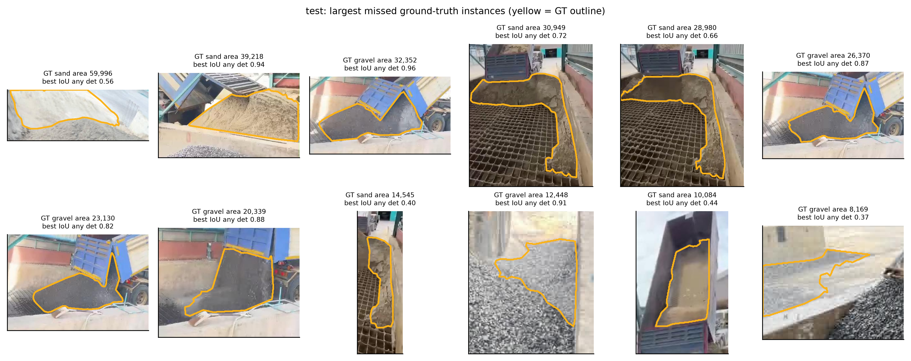

### 6.6 Self-attention ของแบบจำลองที่ตรึงไว้

| โมดูล | token | head | ‖branch‖/‖input‖ (gravel / sand / mixed) | normalized entropy |
|---|---|---:|---|---|
| ชั้น 10 `C2PSA` | 20×20 | 2 | 0.80 / 0.84 / 0.82 | 0.74–0.77 |
| ชั้น 22 `C3k2(attn=True)` | 20×20 | 2 | 0.94 / 1.00 / 0.92 | 0.67–0.72 |

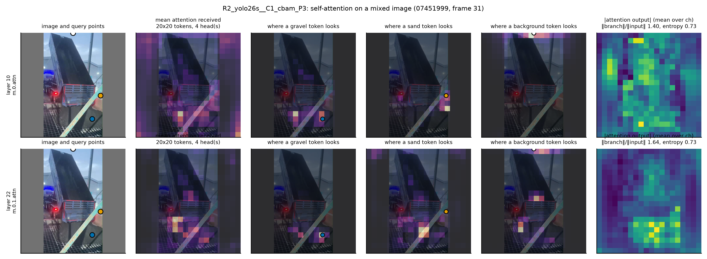

### 6.7 ความทนทาน (val-C, mask AP)

| สถานการณ์ | ระดับ 1 | 2 | 3 | 4 | 5 |
|---|---:|---:|---:|---:|---:|
| dark | 0.552 | 0.548 | 0.526 | 0.432 | 0.223 |
| dust | 0.579 | 0.582 | 0.567 | 0.472 | 0.310 |
| rain | 0.579 | 0.575 | 0.561 | 0.531 | 0.474 |

mPC 0.501, rPC 0.86 ความมืดระดับ 5 ทำให้ mask AP ลดลงมากที่สุด

---

## 7. Notebook 04: holdout, standardization และวิดีโอ

**ชุดข้อมูล:** holdout ภายนอกจาก Roboflow สองชุดที่มี label (piled_materials 1,095 ภาพ และ separate_rock_sand 182 ภาพ ซึ่ง 175 ภาพเป็น mixed) และชุด s02 ที่ไม่มี label (66 ภาพ) holdout ทั้งสามชุดเคยถูกประเมินด้วยแบบจำลองของงานเดิม (notebook 18) จึงไม่ใช่ข้อมูลที่ไม่เคยเห็นโดยสมบูรณ์

### 7.1 ระดับ instance และผลของ standardization

| ชุด | standardization | mask AP | gravel | sand |
|---|---|---:|---:|---:|
| piled_materials | S0 ภาพดิบ | 0.173 | 0.153 | 0.194 |
| | S1 ปรับตามสถิติของชุดพัฒนา | 0.136 | 0.128 | 0.144 |
| separate_rock_sand | S0 | 0.105 | 0.065 | 0.144 |
| | S1 | 0.090 | 0.040 | 0.141 |

ผลต่างแบบคู่ S1 − S0: piled_materials −0.037 [−0.048, −0.025], separate_rock_sand −0.014 [−0.020, −0.000] standardization ทำให้ผลแย่ลงในทั้งสองชุด

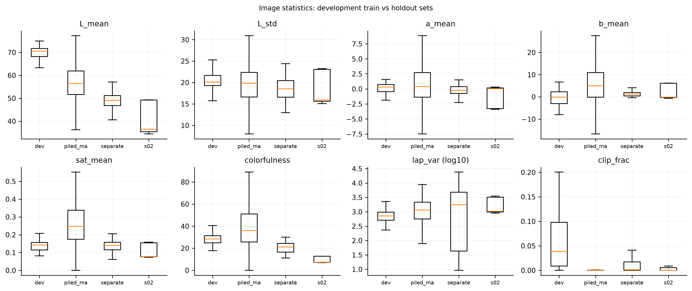

### 7.2 การจำแนกระดับภาพ (S0, threshold ที่ตรึงไว้)

| ชุด | accuracy [CI 95%] | balanced acc. | macro-F1 | มี gravel: P / R / F1 | มี sand: P / R / F1 |
|---|---|---:|---:|---|---|
| piled_materials | 0.574 [0.544, 0.605] | 0.428 | 0.378 | 0.652 / 0.737 / 0.692 | 0.714 / 0.906 / 0.798 |
| separate_rock_sand | 0.236 [0.145, 0.350] | 0.061 | 0.098 | 0.989 / 0.525 / 0.686 | 0.969 / 0.525 / 0.681 |

บน piled_materials แบบจำลองทาย sand บ่อยเกินไป (recall 0.91, specificity 0.52) บน separate_rock_sand แบบจำลองตรวจพบวัสดุอย่างน้อยหนึ่งชนิดได้แม่นยำ แต่พลาดวัสดุชนิดที่สองในภาพ mixed (recall ของ mixed 0.25) ชุด s02 ถูกทายเป็น none 61% และ mixed 39%

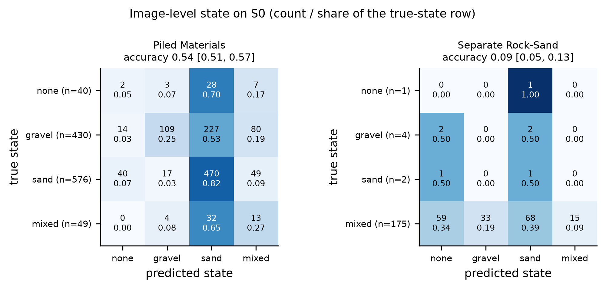


### 7.3 วิดีโอ: overlay และลำดับสถานะ

ทำนายทุก 3 เฟรม (ประมาณ 10 Hz) ทำให้เรียบด้วย EMA (α = 0.3) และ hysteresis k-of-n (3 of 5)

| วิดีโอ | ความยาว | ความสัมพันธ์กับชุดข้อมูล | ลำดับสถานะ (smoothed) | สลับสถานะ raw / smoothed |
|---|---:|---|---|---:|
| `0a48349e` | 55.5 s | กลุ่มใน test (sand) | none → sand (sand 99.6%) | 0 / 1 |
| `32842c3f` | 19.8 s | ไม่อยู่ในชุดพัฒนา | none → gravel → mixed → gravel → mixed → gravel (gravel 86%, mixed 13%) | 18 / 5 |
| `5d81688a` | 20.8 s | กลุ่มใน test (gravel) | none → gravel (gravel 99%) | 6 / 1 |

ช่วง none 0.2 วินาทีแรกของทุกคลิปเกิดจาก hysteresis ซึ่งต้องการ 3 เฟรมก่อนเปลี่ยนสถานะ ไม่ใช่ผลของแบบจำลอง วิดีโอ overlay ความละเอียดเต็มอยู่ใน `outputs/04_holdout/temporal/pred_overlay_<id>.mp4`

| `0a48349e` | `32842c3f` | `5d81688a` |
|---|---|---|
| 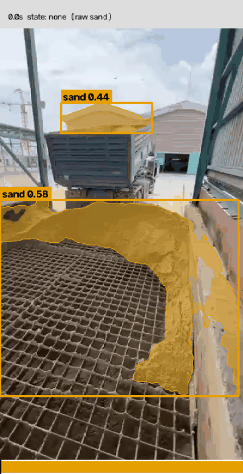 | 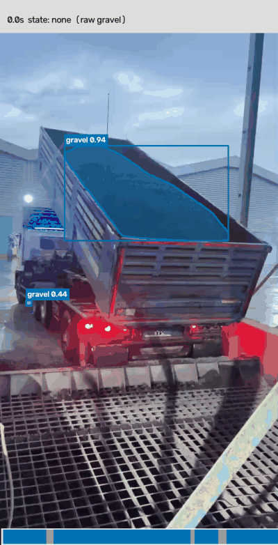 | 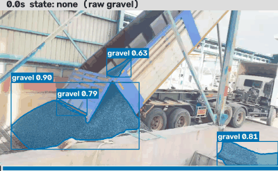 |

การประเมินระดับเวลา (frame-wise accuracy, segmental F1, Edit score) ยังไม่ได้ทำ เพราะยังไม่มี label ช่วงเวลาที่ผู้วิจัยยืนยันแล้ว

---

## 8. ข้อจำกัด

1. **ชุด val มีขนาดเล็กมาก** (131 ภาพ จาก 3 กลุ่ม และมี sand เพียงกลุ่มเดียว) การตัดสินใจทั้งหมดใน Notebook 02–03 ใช้ความแปรปรวนจาก 3 ฉากนี้ ความต่างระดับ 0.01–0.02 ระหว่าง arm จึงอาจเป็นผลเฉพาะฉาก ผลบน val สูงกว่า grouped CV (0.415) และ test (0.437) อย่างชัดเจน
2. **จำนวน seed น้อย** baseline มี 3 seed และ arm สถาปัตยกรรมมี 2 seed เกณฑ์ "ดีกว่า baseline เกิน 1 SD" ใช้ SD ที่ประมาณจากตัวอย่างน้อย (SD ของ baseline 0.0002–0.0017)
3. **ช่วงความเชื่อมั่นของ test กว้าง** เพราะมี 7 กลุ่ม และ 4 กลุ่มมีเพียง 1 ภาพ (mask AP [0.22, 0.64], sand [0.00, 0.44])
4. **annotation ไม่สม่ำเสมอ** วัสดุในกระบะรถถูก label เพียงบางส่วนในหลายภาพ และกองเดียวที่ถูกบดบังถูกแบ่งเป็นหลาย polygon ทำให้ metric ระดับ instance ลงโทษ mask ที่ครอบทั้งกอง
5. **ตัวแปรกวนของแหล่งที่มา** คลาสผูกกับฉาก (V = 0.98) และ shortcut test พบว่าคะแนนของ sand คงอยู่ 41% หลังลบวัสดุออก
6. **holdout ไม่เป็นอิสระโดยสมบูรณ์** ถูกประเมินด้วยแบบจำลองของงานเดิมมาก่อน ส่วนวิดีโอสองในสามคลิปมาจากกลุ่มเดียวกับชุด test
7. **attention ที่เพิ่มเริ่มจากค่าสุ่ม** บล็อกภายในของ C3k2 ที่เปลี่ยนเป็น `attn=True` ไม่ได้รับน้ำหนัก pretrained (โอนได้ 87–96% ของพารามิเตอร์) และฝึกเพียง 20 epoch ผลลบของ attention จึงอาจมาจากการสูญเสียน้ำหนัก pretrained บางส่วน
8. **CBAM/ECA ใช้การเริ่มต้นแบบ identity** (2·sigmoid และน้ำหนักชั้นสุดท้ายเป็นศูนย์) ซึ่งต่างจากบทความต้นฉบับ
9. **ความเร็วที่รายงานวัดบน GPU สำหรับพัฒนาเท่านั้น** ไม่รวมเวลาของ unsharp masking และยังไม่ได้วัดบน Raspberry Pi 5 หรือหลัง quantization ค่า latency ของการวัดต่างรอบมีความต่างประมาณ 0.4 ms (เช่น baseline 6.93 และ 7.38 ms)
10. **ค่า metric ระหว่างการฝึก** ใช้ตัวประเมินของ Ultralytics ซึ่งต่างจาก pycocotools เล็กน้อย ตัวเลขในรายงานนี้ใช้ pycocotools
11. **การวิเคราะห์ FP/FN ของ augmentation แต่ละ arm** ในหัวข้อ 4 คำนวณด้วย script นอก notebook ที่ conf คงที่ และไม่ได้บันทึกเป็นส่วนหนึ่งของ notebook

---

## 9. Bug ที่ยังไม่แก้ warning และ error

### 9.1 Bug ที่ยังไม่แก้

| # | ตำแหน่ง | อาการ | ผลกระทบ | สถานะ |
|---|---|---|---|---|
| B1 | Notebook 02, `compose_a9` | เลือก offline dataset ได้ชุดเดียวตามลำดับความสำคัญ (A7 มาก่อน A3) ชุดฝึกของ A9 จึงมีเฉพาะ variant rain/dark/dust แต่ `aug_recipe_selected.json` ระบุ `passed_components` ว่ารวม A3_photometric | A9 ไม่ได้ใช้ augmentation เดี่ยวที่ดีที่สุด (A3) ผลของ Notebook 03, 03.5 และ 04 ทั้งหมดอิงสูตรนี้ ต้องอธิบายในวิทยานิพนธ์ว่า A9 จริงคือ A7 + A8 + P5 | **ยังไม่แก้** การแก้ต้องฝึก A9 และ Notebook 03 ใหม่ และต้องรายงานเป็นการวิเคราะห์หลังเปิด test |
| B2 | Notebook 03 / 04 preprocessing | ไม่ได้ implement `P3_gamma_auto` ซ้ำ เพราะต้องใช้ค่า `TARGET_L` จาก Notebook 02 | ถ้าการรันในอนาคตเลือก P3 Notebook 03/04 จะหยุดด้วย `AssertionError` | ยังไม่แก้ (ไม่กระทบผลปัจจุบัน) |
| B3 | Notebook 03.5 หัวข้อ 15 | ไม่ได้เรียก `size_analysis` สำหรับ test | ไม่มีตาราง recall ตามขนาดของ test (มีเฉพาะ COCO AP_small/medium/large) | ยังไม่แก้ |
| B4 | Notebook 03 หัวข้อ 6.1 | ภาพที่ใช้แสดง attention มีเฉพาะ gravel จึงไม่มี query ของ sand | แสดงผล attention ของ sand ใน Notebook 03.5 แทน | ยังไม่แก้ |
| B5 | Notebook 03/04 การรันซ้ำ | cell ประเมิน test และ holdout หยุดด้วย `SystemExit` เมื่อมีไฟล์ `*_OPENED.json` | รันทั้ง notebook ซ้ำด้วย nbconvert ไม่ได้แล้ว (ตั้งใจ เพื่อป้องกันการเปิดผลซ้ำ) | ตามการออกแบบ |

### 9.2 Bug ที่แก้แล้วระหว่างการรัน

| ตำแหน่ง | อาการ | การแก้ |
|---|---|---|
| Notebook 02 cell `ultra_samples` | `TypeError: dict() got multiple values for keyword argument 'hsv_h'` | รวม `{**BASE_OFF, **overrides}` ก่อนส่งเข้า `get_cfg` |
| Notebook 03 cell การประเมิน | `AssertionError: preprocessing P5_unsharp must be re-implemented` | เพิ่ม `P4_nlmeans` และ `P5_unsharp` โดยคัดลอกจาก Notebook 02 |
| Notebook 04 cell การโหลดการตั้งค่า | assertion เดียวกับข้างบน (จะเกิดเมื่อรัน) | เพิ่ม `P4_nlmeans` และ `P5_unsharp` |
| Notebook 04 การโหลด attention | `KeyError` เมื่อ attention เป็น C3k2 | โหลด `ATT_SPEC` เฉพาะ CBAM/ECA |

### 9.3 Warning ที่พบในการรันล่าสุด

| Warning | Notebook | จำนวน | ผลต่อผลลัพธ์ |
|---|---|---:|---|
| Ultralytics `'half' is deprecated ... Use 'quantize'` | 02, 03, 04 | 6,353 | ไม่มี (`half=False` ถูกแปลงเป็น `quantize=None` คือ FP32) แต่จะใช้ไม่ได้เมื่อ Ultralytics ลบ argument นี้ |
| sklearn `y_pred contains classes not in y_true` | 02, 03 | 251 | ไม่มี เกิดเมื่อแบบจำลองทายสถานะที่ไม่มีในป้ายของชุดนั้น balanced accuracy คำนวณตามนิยามจาก y_true |
| sklearn `A single label was found` และ `UndefinedMetricWarning` (Cohen's κ) | 03 (bootstrap บน test) | 20 | บางรอบของ bootstrap มีสถานะเดียว κ จึงเป็น NaN ในรอบนั้น และช่วงความเชื่อมั่นของ macro-F1 บน test กว้าง [0.31, 1.00] |
| pandas `arguments of sum will be keyword-only` | 03.5 หัวข้อ 14 | 1 | ไม่มีใน pandas ปัจจุบัน แต่จะเป็น error ใน pandas 4 (`sp.sum(1)` ต้องเป็น `sp.sum(axis=1)`) |
| `Kernel is running over TCP without encryption` | ทุก notebook (log ของ nbconvert) | — | ไม่มี เป็นข้อความของ Jupyter ในเครื่อง |

### 9.4 Error

การรันล่าสุดของทั้ง 5 notebook ไม่มี error ใน output ของ cell (02: 16/27 cell มี output, 03: 31/37, 03.5: 21/23, 04: 21/24 ส่วน cell ที่ไม่มี output เป็น cell ที่นิยามฟังก์ชันหรือถูกข้ามด้วย flag)

---

## 10. การรันซ้ำ

### สภาพแวดล้อม

```bash
cd implement/research
uv venv .venv --python 3.12
uv pip install --python .venv/bin/python -r requirements.lock.txt
.venv/bin/python -m ipykernel install --user --name aggregate-research --display-name "Python 3.12 (aggregate-research)"
```

### ลำดับการรันและด่านตรวจ

| ลำดับ | Notebook | flag | เวลาโดยประมาณ (RTX 3080 Ti) | ผลลัพธ์ |
|---|---|---|---|---|
| 1 | `01_eda_and_dataset_splitting.ipynb` | — | ~1 นาที | split, Silver, `manifests/` |
| 2 | `02_preprocessing_and_augmentation.ipynb` | `RUN_TRAINING = True` | ~2.5 ชั่วโมง | `configs/aug_recipe_selected.json` |
| 3 | `03_yolo_training_architecture_and_benchmarking.ipynb` | `RUN_TRAINING`, `RUN_TEST_EVAL` (ครั้งเดียว), `RUN_EXPORT` | ~2.5 ชั่วโมง | `configs/frozen_inference.yaml`, `TEST_OPENED.json` |
| 3.5 | `03.5_best_model_evaluation.ipynb` | `RUN_VALC`, `RUN_SPEED` | ~3 นาที | `outputs/03.5_best_model_evaluation/` |
| 4 | `04_holdout_standardization_and_final_evaluation.ipynb` | `RUN_HOLDOUT_EVAL` (ครั้งเดียว), `RUN_TEMPORAL_EVAL` | ~5 นาที | `HOLDOUT_OPENED.json`, GIF ของวิดีโอ |

```bash
cd notebooks
../.venv/bin/jupyter nbconvert --to notebook --execute --inplace \
  --ExecutePreprocessor.timeout=-1 --ExecutePreprocessor.kernel_name=aggregate-research <notebook>.ipynb
```

### กติกาที่โค้ดบังคับ

- **การฝึก:** ทุก run อยู่ในโฟลเดอร์ `<arm>_s<seed>_<hash ของการตั้งค่า>` run ที่เสร็จแล้ว (`DONE.json`) จะถูกข้าม และ run ที่ค้างจะ resume จาก `last.pt`
- **ชุด test และ holdout:** Notebook 02–03 ไม่โหลดภาพ test (`guard_not_test`) จนถึง cell ประเมินสุดท้าย ซึ่งเปิดได้ครั้งเดียว Notebook 04 ใช้เฉพาะการตั้งค่าที่ตรึงแล้วและตรวจ SHA-256 ของ checkpoint
- **ชุดข้อมูล:** ชื่อโฟลเดอร์มี hash ของเนื้อหา ประวัติเวอร์ชันอยู่ใน `manifests/dataset_versions.json`

### โครงสร้าง

```
notebooks/   01, 02, 03, 03.5, 04
data/        silver_<hash>, dev_<hash>, offline_aug_*, preproc_*, val_c_*, holdout_*, videos/
manifests/   รายชื่อภาพ กลุ่ม split checksum และผลการตรวจ Silver
configs/     aug_recipe_selected.json, frozen_inference.yaml
outputs/     01_eda, 02_preprocessing_augmentation, 03_yolo_experiments/{baseline, optimizer_comparison,
             architecture_ablations, feature_maps, layer_benchmarks, evaluation, cv, _archive_frozen},
             03.5_best_model_evaluation, 04_holdout/{figures, tables, temporal}
weights/     yolo26n-seg.pt (SHA-256 361fbfab…)
```
